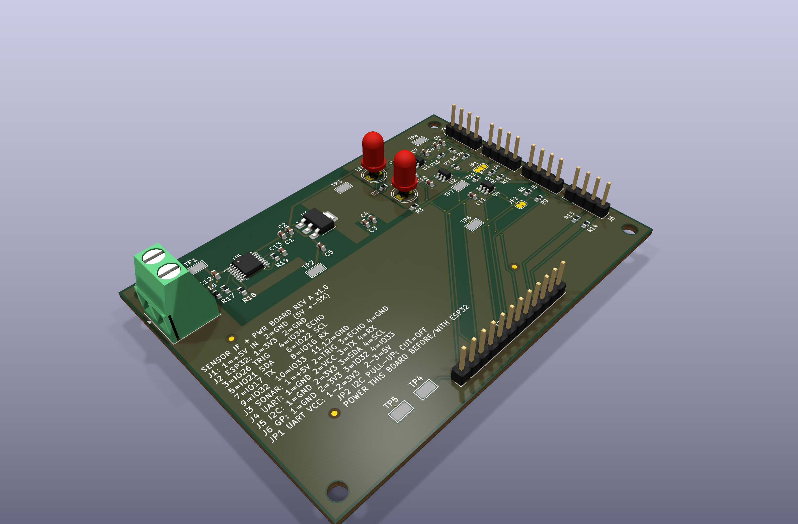
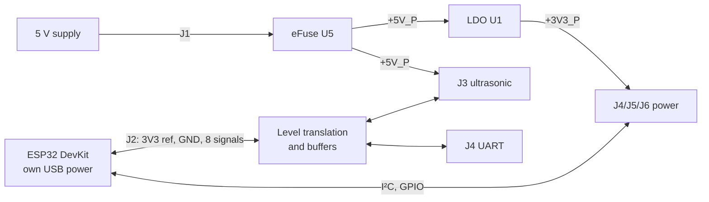
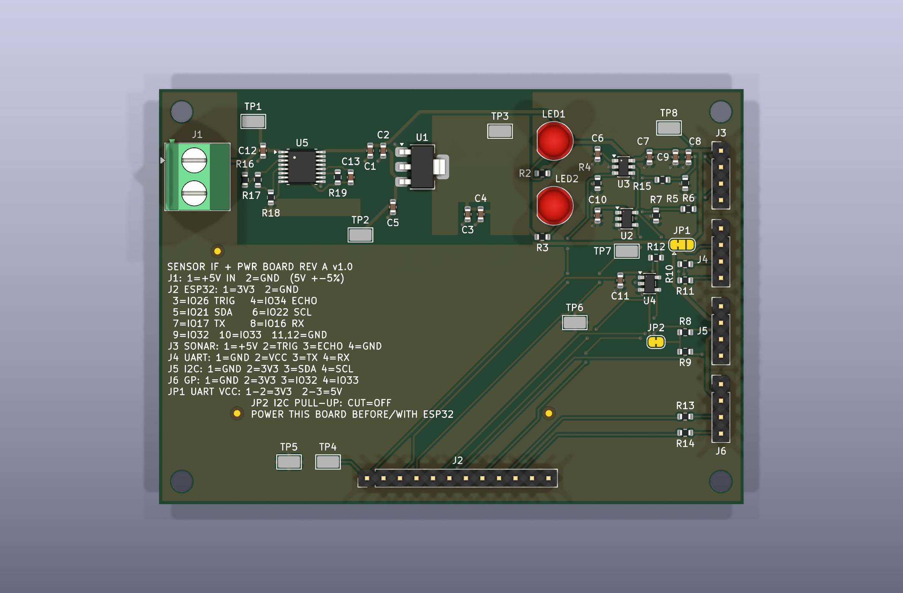
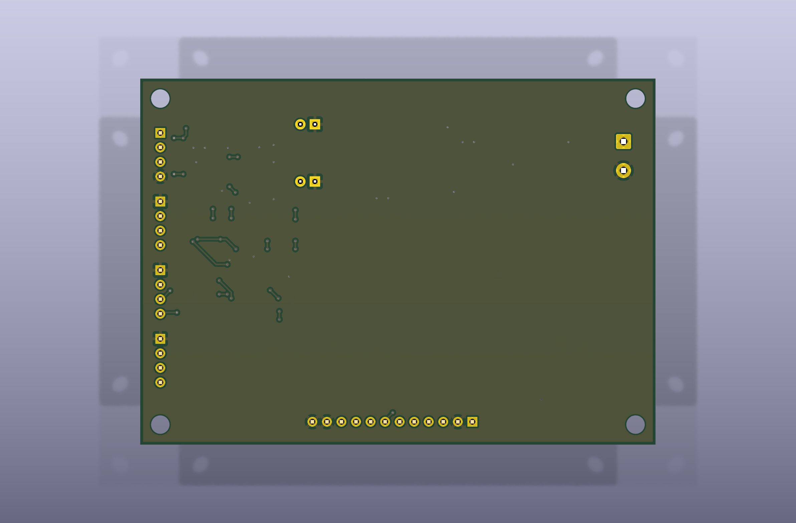
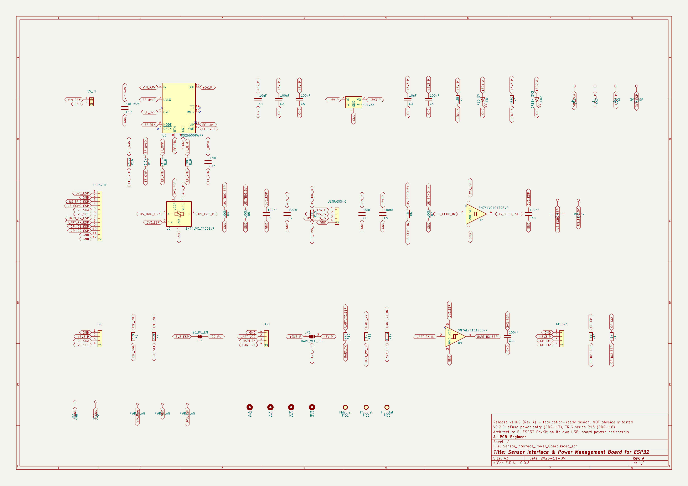
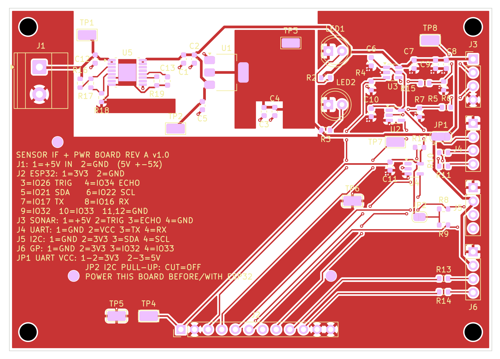

# Sensor Interface & Power Management Board

A modular PCB designed to provide protected power distribution, voltage regulation, signal conditioning, and
sensor connectivity for ESP32-based embedded systems.

| | |
|---|---|
| **Release** | v1.0.0, board **Rev A** |
| **Status** | **DIGITALLY VALIDATED DESIGN — NOT PHYSICALLY FABRICATED OR TESTED** |
| **Tool** | KiCad 10.0.8 |
| **Licence** | Hardware CERN-OHL-P-2.0 · software MIT · third-party material under its own terms (see [License](#22-license)) |

> **v1.0.0 means "fabrication-ready open hardware design release".** The schematic, layout and manufacturing
> files passed every digital check (ERC, DRC, schematic parity, file audits). No board has been manufactured,
> assembled, powered or measured yet. Treat the first build as a prototype.

**Quick links:**
[KiCad project](hardware/kicad/Sensor_Interface_Power_Board/) ·
[Fabrication ZIP](manufacturing/Sensor_Interface_Power_Board/RevA/packages/Sensor_Interface_PCB_RevA_Fabrication.zip) ·
[Assembly ZIP](manufacturing/Sensor_Interface_Power_Board/RevA/packages/Sensor_Interface_PCB_RevA_Assembly.zip) ·
[Complete manufacturing ZIP](manufacturing/Sensor_Interface_Power_Board/RevA/packages/Sensor_Interface_PCB_RevA_Complete_Manufacturing.zip) ·
[BOM](manufacturing/Sensor_Interface_Power_Board/RevA/assembly/Sensor_Interface_Power_Board_RevA_BOM.csv) ·
[CPL](manufacturing/Sensor_Interface_Power_Board/RevA/assembly/Sensor_Interface_Power_Board_RevA_CPL.csv) ·
[Schematic PDF](manufacturing/Sensor_Interface_Power_Board/RevA/assembly/Sensor_Interface_Power_Board_RevA_schematic.pdf) ·
[STEP](manufacturing/Sensor_Interface_Power_Board/RevA/3d/Sensor_Interface_Power_Board_RevA.step) ·
[Datasheets](datasheets/) ·
[Validation reports](reports/v0.3.0/) ·
[Quick start](docs/getting-started/QUICK_START.md)

## 1. Overview
The board sits next to an **ESP32 DevKit** (designed against the ESP32-DevKitC V4 / ESP32-WROOM-32E pin labels)
and connects to it with 12 wires. It takes an external 5 V supply through an eFuse that provides overvoltage,
undervoltage, reverse-polarity and overcurrent protection. It generates a separate 3.3 V rail for peripherals and
translates the 5 V signals of an HC-SR04-style ultrasonic sensor to the ESP32's 3.3 V logic. It also brings out
labelled I²C, UART and GPIO headers. **The ESP32 is not on this board** and keeps its own USB power.

## 2. Design Objectives
- Protect the peripherals and the regulator from wrong or out-of-range 5 V inputs.
- Keep the ESP32's own supply independent: no back-feed between board rails and the DevKit.
- Make the 5 V ultrasonic sensor safe for 3.3 V GPIOs in both directions.
- Two layers, single-sided assembly, standard design rules, so any PCB factory can build and assemble it.
- Every design value traceable to a datasheet, a calculation or a recorded decision.

## 3. Key Features
- **TPS26600 eFuse input:** OVP 5.39–5.82 V, UVLO 4.25–4.56 V, reverse-polarity blocking, 0.51–0.69 A current limit with auto-retry, ~2 ms soft start.
- **3.3 V / 250 mA peripheral rail** (TLV1117LV33, SOT-223 with 251 mm² heat-spreading copper).
- **Ultrasonic interface:** SN74LVC1T45 3.3 → 5 V TRIG driver, SN74LVC1G17 5 V-tolerant ECHO buffer, fail-safe pull-downs.
- **I²C** header with switchable 2.2 kΩ pull-ups, **UART** header with 3.3 V / 5 V VCC selection and buffered RX, **2 GPIO** with 1 kΩ series protection.
- 8 test points, 2 power LEDs, 4 × M3 holes, 3 fiducials, full pin legend on the silkscreen.

## 4. System Architecture

Details: [docs/system-architecture/BOARD_ARCHITECTURE.md](docs/system-architecture/BOARD_ARCHITECTURE.md).

## 5. Electrical Architecture
| Rail | Source | Use |
|---|---|---|
| `VIN_RAW` | J1, 5 V ±5 % | eFuse input |
| `+5V_P` | eFuse output | LDO input, ultrasonic VCC, 5 V side of the TRIG translator, LED1 |
| `+3V3_P` | board LDO | I²C, UART (default) and GPIO header supply, LED2 |
| `3V3_ESP` | DevKit 3V3 pin via J2-1 | **logic reference only** for U2–U4 and pull-ups |
| `EF_RTN` | eFuse reference island | **not ground**, never connect to GND |

`+3V3_P` and `3V3_ESP` are never connected. The DevKit 5V pin is not used. Full description:
[docs/electrical-design/ELECTRICAL_DESIGN.md](docs/electrical-design/ELECTRICAL_DESIGN.md).

## 6. Supported Interfaces
| Connector | Function | Pins (1 → n) |
|---|---|---|
| J1 | 5 V power input (screw terminal, 5.08 mm) | +5V, GND |
| J2 | ESP32 interface (1×12, 2.54 mm) | 3V3_ESP, GND, TRIG, ECHO, SDA, SCL, TX, RX, IO1, IO2, GND, GND |
| J3 | Ultrasonic sensor (1×4) | +5V, TRIG, ECHO, GND |
| J4 | UART (1×4) | GND, VCC (3.3 V / 5 V), TX, RX |
| J5 | I²C (1×4) | GND, 3V3, SDA, SCL |
| J6 | GPIO (1×4, 3.3 V only) | GND, 3V3, IO1, IO2 |

Pin-by-pin tables with voltage, direction and destination:
[docs/pinout/CONNECTION_GUIDE.md](docs/pinout/CONNECTION_GUIDE.md).

## 7. ESP32 Compatibility
Designed for the **ESP32-DevKitC V4 (ESP32-WROOM-32E)** pin labels: GPIO26 (TRIG), GPIO34 (ECHO, input-only),
GPIO21/22 (I²C), GPIO17/16 (UART2 TX/RX), GPIO32/33 (GPIO), 3V3 and GND. Any ESP32 board that exposes these
GPIOs and a 3.3 V pin can be wired the same way by label, but other boards have **not** been checked. The
DevKit is connected by wires, so its mechanical dimensions do not matter.

## 8. Ultrasonic Interface
For HC-SR04-style 5 V modules. TRIG is driven at 5 V (≥ 4.54 V high) through a level translator and 1 kΩ. ECHO
(0–5 V) is buffered to 3.3 V by a 5.5 V-tolerant Schmitt buffer. **Connect the module with four separate jumper
wires, matched by the printed labels (VCC, Trig, Echo, GND).** Module pin order is not universal and has not been verified.

## 9. Power Distribution
- Input **5.0 V ±5 %**, isolated supply recommended, ≥ 0.7 A capability.
- Total input current limited to 0.51–0.69 A by the eFuse.
- **+3V3_P: ≤ 250 mA continuous at ≤ 50 °C ambient** (LDO thermal limit, calculated).
- **Power-up rule R-31:** power the board **before or together with** the ESP32 (also printed on the board).

## 10. PCB Specifications
| Item | Value |
|---|---|
| Size | 90.0 × 64.0 mm, 4 × M3 mounting holes |
| Layers / material | 2 layers, FR-4, 1.6 mm, 1 oz copper |
| Finish | ENIG preferred (lead-free HASL acceptable) |
| Min track / clearance / hole | 0.25 mm / 0.20 mm / 0.3 mm |
| Assembly | Top side only: 44 SMT + 8 THT parts (52 placements, 33 BOM lines) |
| Routing | 331 track segments, 57 vias, solid GND plane on the bottom |

## 11. Images and 3D Renders
| Top (3D) | Bottom (3D) |
|---|---|
|  |  |

All renders are generated by KiCad from the design, with library 3D models (shape only). More views:
[docs/visual-review/VISUAL_REVIEW.md](docs/visual-review/VISUAL_REVIEW.md).

## 12. Schematic Preview

[Full schematic PDF](manufacturing/Sensor_Interface_Power_Board/RevA/assembly/Sensor_Interface_Power_Board_RevA_schematic.pdf)

## 13. PCB Layout Preview

Layout notes: [docs/pcb-layout/PCB_LAYOUT.md](docs/pcb-layout/PCB_LAYOUT.md).

## 14. Component List
Main parts (full BOM with all 33 lines, sourcing notes and verified alternatives:
[BOM CSV](manufacturing/Sensor_Interface_Power_Board/RevA/assembly/Sensor_Interface_Power_Board_RevA_BOM.csv)):

| Ref | Part | Function |
|---|---|---|
| U5 | TI TPS26600PWPR | eFuse: OVP, UVLO, reverse polarity, current limit |
| U1 | TI TLV1117LV33DCYR | 3.3 V LDO |
| U3 | TI SN74LVC1T45DBVR | TRIG level translator 3.3 → 5 V |
| U2, U4 | TI SN74LVC1G17DBVR | ECHO and UART RX buffers (5.5 V-tolerant inputs) |
| J1 | Phoenix Contact 1715721 | 5 V screw terminal |
| J2–J6 | Samtec HTSW-112/104-07-T-S | 2.54 mm headers |
| LED1, LED2 | Kingbright WP7113ID / WP7113SGD | +5 V / +3.3 V indicators |

**Sourcing note (2026-11-09):** TPS26600PWPR is active but had no distributor stock confirmed on that date. See
[reports/v0.3.0/BOM_SOURCING_AUDIT.md](reports/v0.3.0/BOM_SOURCING_AUDIT.md).

## 15. Manufacturing Files
| Package | Contents |
|---|---|
| [Sensor_Interface_PCB_RevA_Fabrication.zip](manufacturing/Sensor_Interface_Power_Board/RevA/packages/Sensor_Interface_PCB_RevA_Fabrication.zip) | Gerber X2, Excellon, drill maps, IPC-D-356, fabrication notes |
| [Sensor_Interface_PCB_RevA_Assembly.zip](manufacturing/Sensor_Interface_Power_Board/RevA/packages/Sensor_Interface_PCB_RevA_Assembly.zip) | BOM, CPL, assembly drawings, schematic, assembly notes, connector pinout |
| [Sensor_Interface_PCB_RevA_Complete_Manufacturing.zip](manufacturing/Sensor_Interface_Power_Board/RevA/packages/Sensor_Interface_PCB_RevA_Complete_Manufacturing.zip) | all of the above + STEP |
| [SHA256SUMS.txt](manufacturing/Sensor_Interface_Power_Board/RevA/checksums/SHA256SUMS.txt) | checksums of every package and file |

Unzipped sources: [manufacturing/Sensor_Interface_Power_Board/RevA/](manufacturing/Sensor_Interface_Power_Board/RevA/).

## 16. How to Open the KiCad Project
1. Install **KiCad 10.0.x** (KiCad 9 cannot open these files).
2. Open [`hardware/kicad/Sensor_Interface_Power_Board/Sensor_Interface_Power_Board.kicad_pro`](hardware/kicad/Sensor_Interface_Power_Board/).
3. No setup is needed. The only custom footprint (U5, TI PWP0016A) is in the project library
   `Sensor_Interface_Power_Board.pretty`, loaded through `${KIPRJMOD}`. Symbols are embedded. 3D models come from
   the standard KiCad 10 library.
4. To regenerate all outputs and re-run all checks: `scripts/release/build_release.sh` (Bash + KiCad 10).

## 17. How to Manufacture the PCB
Upload the Fabrication ZIP to any PCB manufacturer with these options: 2 layers, FR-4, 1.6 mm, 1 oz, 90 × 64 mm,
ENIG, electrical test. Step-by-step guide: [docs/manufacturing/HOW_TO_MANUFACTURE.md](docs/manufacturing/HOW_TO_MANUFACTURE.md).

## 18. How to Request Full Assembly
Choose **turnkey, top-side, lead-free SMT + THT** assembly and upload the BOM and CPL. Ask the factory to confirm
THT soldering of the 8 through-hole parts, sourcing of every exact MPN (especially TPS26600PWPR) and **no
substitution without your written approval**. Details:
[docs/assembly/FULL_ASSEMBLY_REQUIREMENTS.md](docs/assembly/FULL_ASSEMBLY_REQUIREMENTS.md). Researched (not
confirmed) suppliers: [manufacturer-profiles/](manufacturing/Sensor_Interface_Power_Board/manufacturer-profiles/).

## 19. Safety and Power Requirements
- 5 V DC only, isolated supply recommended. Never apply more than 50 V to J1, even reversed.
- **Reverse polarity is blocked only when no other earthed equipment shares the ground.** If the supply's
  negative terminal is earthed and the ESP32 is plugged into an earthed PC, a reversed J1 short-circuits the
  supply through the ground wires and the USB cable. Check polarity, power the board first, connect USB last.
- No surge/ESD protection is claimed. The LDO can run hot (~95 °C estimated) at full rating.

Full text: [docs/safety/SAFETY_AND_POWER.md](docs/safety/SAFETY_AND_POWER.md).

## 20. Verification Status
| Check | Result |
|---|---|
| ERC (all severities) | 0 |
| DRC (all severities, zones refilled) | 0 errors, 0 warnings |
| Unconnected items / schematic parity | 0 / 0 |
| Netlist and power-domain verifier | PASS |
| Manufacturing package audit, ZIP extraction test | PASS |
| **Physical fabrication, assembly, power-up, measurements** | **NOT DONE** |

Digital evidence: [docs/validation/DIGITAL_VALIDATION.md](docs/validation/DIGITAL_VALIDATION.md) ·
physical test plan: [docs/validation/PHYSICAL_VALIDATION_STATUS.md](docs/validation/PHYSICAL_VALIDATION_STATUS.md) ·
engineering audit: [reports/v0.3.0/FINAL_ENGINEERING_AUDIT.md](reports/v0.3.0/FINAL_ENGINEERING_AUDIT.md).

## 21. Known Limitations
1. **Not fabricated, not tested.** All performance figures are datasheet values or calculations.
2. Reverse-polarity protection does not cover earth-referenced ground loops (see §19).
3. No surge protection. A fast overvoltage step (> ~24 V/ms) while powered is not covered.
4. +3V3_P limited to 250 mA at ≤ 50 °C (thermal, calculated).
5. Power-sequencing rule R-31 (board first or together with the ESP32).
6. Ultrasonic module pin order, mating connectors and enclosure fit not verified.
7. TPS26600PWPR stock was not confirmed at release time.
8. J6 GPIOs and all J2 signals are 3.3 V only.

## 22. License
The repository is **not** under a single licence. The distinction:

### Hardware: `CERN-OHL-P-2.0`
Original hardware design files and associated hardware documentation are distributed under the **CERN Open
Hardware Licence Version 2 – Permissive** ([LICENSE-HARDWARE](LICENSE-HARDWARE), official text). This covers only
material identified as project hardware source in [LICENSE_SCOPE.md](LICENSE_SCOPE.md):
- KiCad schematic, PCB and project;
- manufacturing outputs and packages;
- renders;
- hardware documentation and reports.

It permits copying, modification, manufacturing and selling, including commercially. When you convey the source,
keep the notices ([NOTICE.md](NOTICE.md)). When you convey a modified version, add a modification notice
([MODIFICATIONS.md](MODIFICATIONS.md)).

### Software: `MIT`
Original project software and scripts (`*.py`, `*.sh`: release, build, verification and calculation scripts) and
the AI-toolchain material are distributed under the **MIT License** ([LICENSE-CODE](LICENSE-CODE)).

### Third-party materials
Third-party material remains under its own terms. See [THIRD_PARTY_NOTICES.md](THIRD_PARTY_NOTICES.md):
- The U5 footprint is a modified KiCad library footprint and stays under
  `CC-BY-SA-4.0 WITH KiCad-libraries-exception`.
- KiCad library data embedded in the design and generated files is covered by that exception.
- Datasheets are **not** redistributed; only links are given.
- Trademarks belong to their owners.

Machine-readable map: [REUSE.toml](REUSE.toml). Plain-language guide:
[docs/licensing/LICENSING_GUIDE.md](docs/licensing/LICENSING_GUIDE.md).

The design is provided "as is" (CERN-OHL-P §5, MIT). CERN does not endorse this project. The project is **not**
OSHWA-certified.

## 23. Revision History
| Version | Date | Board rev | Summary |
|---|---|---|---|
| **1.0.0** | 2026-11-09 | **A** | Fabrication-ready open-hardware release: final engineering audit, Rev A label, regenerated and audited manufacturing packages, documentation |
| 0.2.0 | 2026-11-09 | 0.2.0 | Complete PCB layout, eFuse power entry, manufacturing package |
| 0.1.0 | 2026-11-08 | — | Requirements, component selection, complete schematic |
| 0.0.1–0.0.3 | 2026-11-07/08 | — | Toolchain setup and MCP capability evaluation |

Full history: [CHANGELOG.md](CHANGELOG.md). Design reports per version: [reports/](reports/).

---
### About the design process
The board was designed with an AI-assisted workflow (Claude Code → KiCAD-MCP-Server → KiCad 10) under the rules in
[CLAUDE.md](CLAUDE.md) and [docs/ENGINEERING_RULES.md](docs/ENGINEERING_RULES.md). Every result was checked
independently with `kicad-cli` and scripts. Toolchain setup: [docs/ai-workflow/AI_TOOLCHAIN_SETUP.md](docs/ai-workflow/AI_TOOLCHAIN_SETUP.md).
Repository map: [docs/README.md](docs/README.md). Contributing: [CONTRIBUTING.md](CONTRIBUTING.md).
