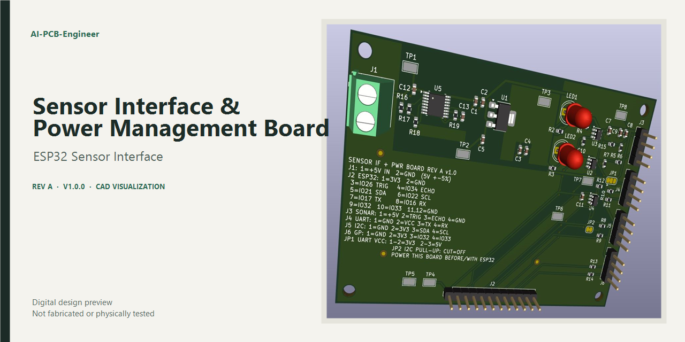
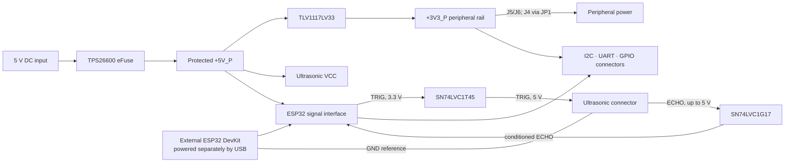
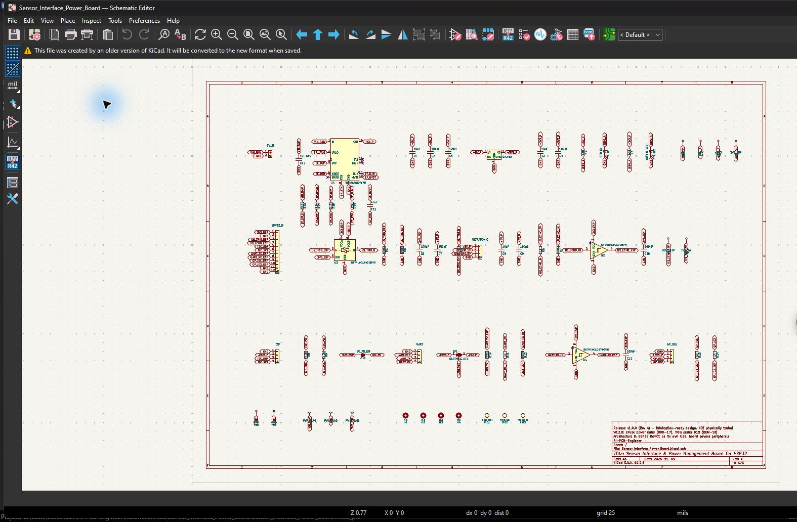
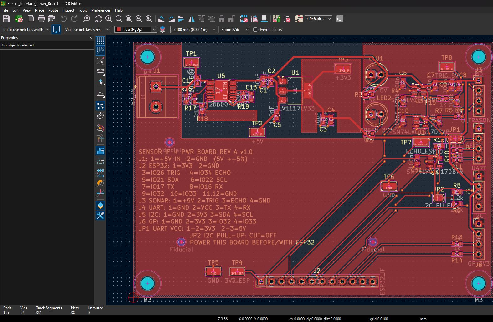
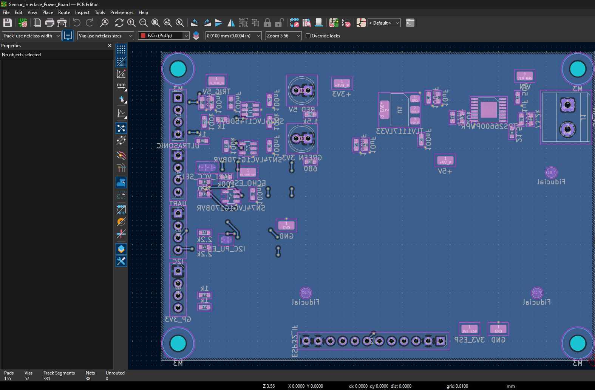
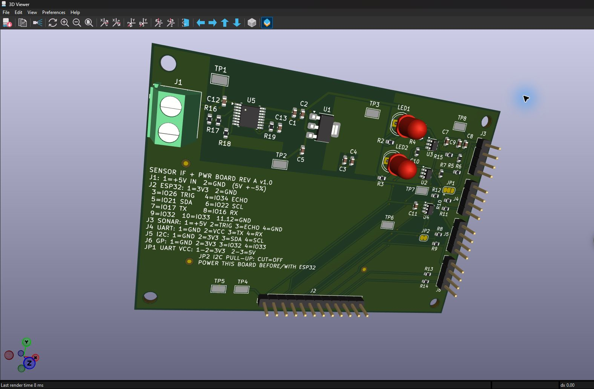
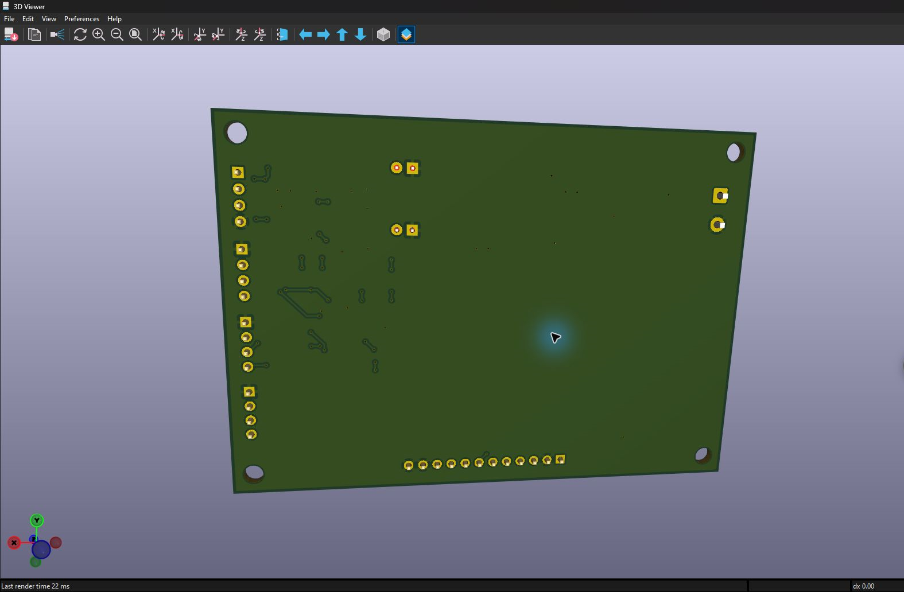
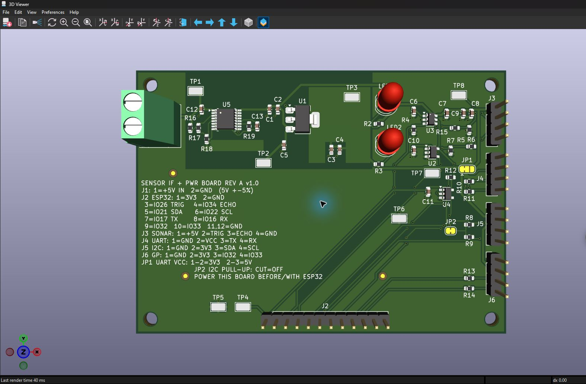

# AI-PCB-Engineer

An open-source electronics project delivering a protected sensor interface and peripheral power board for an **external ESP32 DevKit**.

> **Featured hardware:** Sensor Interface & Power Management Board for ESP32 · Rev A · V1.0.0
> CAD visualization only — **not fabricated or physically tested**.

## What is this PCB?

The board organizes power and signal connections between an ESP32 DevKit and compatible peripherals. It provides protected 5 V distribution, a regulated 3.3 V peripheral rail, conditioned sensor signals, and I²C, UART, and GPIO headers. The ESP32 is a separate development board and is powered through its own USB connection.

## Problem and solution

ESP32 GPIO uses 3.3 V logic and is not 5 V tolerant. Some 5 V ultrasonic modules can return a 5 V ECHO signal, which may exceed an ESP32 input's limits. Loose jumper-wire circuits also make power and signal wiring easier to get wrong.

This board provides a documented connector layout and dedicated signal conditioning: an SN74LVC1T45 translates ESP32 TRIG to the sensor's 5 V logic side, while an SN74LVC1G17 conditions ECHO for the ESP32. It also supplies protected 5 V and regulated 3.3 V peripheral power. Compatibility depends on the module's actual pinout and electrical characteristics; follow the [connector guide](docs/pinout/CONNECTION_GUIDE.md).

**Power regulation** creates a regulated supply rail. **Signal conditioning** adapts signal levels for compatible communication. They are separate circuits on this board.

## How it works

`+3V3_P` powers peripherals. `3V3_ESP` is a separate ESP32 logic reference; the two rails are not connected together. See the [system architecture](docs/system-architecture/BOARD_ARCHITECTURE.md) and [electrical design](docs/electrical-design/ELECTRICAL_DESIGN.md).

## PCB gallery

Captured from the actual V1.0.0 project in KiCad applications. These are GUI screenshots, not command-line exports.

| Full schematic | PCB top layout |
|---|---|
|  |  |

| PCB bottom copper | 3D top view |
|---|---|
|  |  |

| 3D bottom view | Connector details |
|---|---|
|  |  |

[Power management schematic close-up](docs/visual-review/images/screenshots/02-power-management.png) · [All visual-review assets](docs/visual-review/VISUAL_REVIEW.md)

## Key specifications

| Item | Rev A specification |
|---|---|
| Board | 90 × 64 mm; 2 layers; FR-4; 1.6 mm; 1 oz copper |
| Component instances | 44 SMT + 8 THT = 52 |
| Input | Regulated 5 V DC, ±5%; ≥0.7 A recommended supply capacity |
| Peripheral rails | Protected +5V_P; regulated +3V3_P |
| 3.3 V peripheral load | 250 mA maximum, **calculated** at ambient ≤50 °C; not measured |
| Interfaces | ESP32 header, ultrasonic, I²C, UART, general-purpose GPIO |
| Primary protection | TPS26600 eFuse; current limit 0.51–0.69 A per release data |
| Validation | ERC 0; DRC 0 errors / 0 warnings; 0 unconnected; schematic parity 0 |

See [release notes](release/v1.0.0/RELEASE_NOTES_V1.0.0.md) and [digital validation evidence](docs/validation/DIGITAL_VALIDATION.md).

## Main components

- **TPS26600PWPR** — input eFuse with adjustable protection and current management.
- **TLV1117LV33** — regulates protected 5 V to the peripheral 3.3 V rail.
- **SN74LVC1T45** — translates ESP32 TRIG logic to the 5 V sensor side.
- **SN74LVC1G17** — conditions the ECHO input for the ESP32 logic domain.
- **J1–J6** — power input, ESP32, ultrasonic, UART, I²C, and GPIO connections.

[Complete BOM (CSV)](manufacturing/Sensor_Interface_Power_Board/RevA/assembly/Sensor_Interface_Power_Board_RevA_BOM.csv) · [Connector pinout](docs/pinout/CONNECTION_GUIDE.md)

## Downloads

| File | Download |
|---|---|
| KiCad project | [Project file](hardware/kicad/Sensor_Interface_Power_Board/Sensor_Interface_Power_Board.kicad_pro) · [Schematic](hardware/kicad/Sensor_Interface_Power_Board/Sensor_Interface_Power_Board.kicad_sch) · [PCB](hardware/kicad/Sensor_Interface_Power_Board/Sensor_Interface_Power_Board.kicad_pcb) |
| Complete manufacturing package | [ZIP](manufacturing/Sensor_Interface_Power_Board/RevA/packages/Sensor_Interface_PCB_RevA_Complete_Manufacturing.zip) |
| Fabrication package | [ZIP](manufacturing/Sensor_Interface_Power_Board/RevA/packages/Sensor_Interface_PCB_RevA_Fabrication.zip) |
| Assembly package | [ZIP](manufacturing/Sensor_Interface_Power_Board/RevA/packages/Sensor_Interface_PCB_RevA_Assembly.zip) |
| Copper Gerbers | [Top copper](manufacturing/Sensor_Interface_Power_Board/RevA/fabrication/Sensor_Interface_Power_Board-F_Cu.gtl) · [Bottom copper](manufacturing/Sensor_Interface_Power_Board/RevA/fabrication/Sensor_Interface_Power_Board-B_Cu.gbl) |
| Drill files | [Plated](manufacturing/Sensor_Interface_Power_Board/RevA/fabrication/Sensor_Interface_Power_Board-PTH.drl) · [Non-plated](manufacturing/Sensor_Interface_Power_Board/RevA/fabrication/Sensor_Interface_Power_Board-NPTH.drl) |
| Assembly data | [BOM](manufacturing/Sensor_Interface_Power_Board/RevA/assembly/Sensor_Interface_Power_Board_RevA_BOM.csv) · [CPL](manufacturing/Sensor_Interface_Power_Board/RevA/assembly/Sensor_Interface_Power_Board_RevA_CPL.csv) |
| 3D model | [STEP](manufacturing/Sensor_Interface_Power_Board/RevA/3d/Sensor_Interface_Power_Board_RevA.step) |
| Schematic | [PDF](manufacturing/Sensor_Interface_Power_Board/RevA/assembly/Sensor_Interface_Power_Board_RevA_schematic.pdf) |

## How to use

1. Supply the PCB with the specified regulated 5 V input.
2. Power the external ESP32 DevKit separately through its own USB connector.
3. Connect ESP32 signals using the documented interface and pinout.
4. Connect a compatible sensor using its documented connector labels and electrical requirements.
5. Follow the [power and safety requirements](docs/safety/SAFETY_AND_POWER.md), including sequencing rule R-31.

## Manufacturing

Download the [complete manufacturing ZIP](manufacturing/Sensor_Interface_Power_Board/RevA/packages/Sensor_Interface_PCB_RevA_Complete_Manufacturing.zip) or the separate fabrication and assembly packages. Ask a compatible supplier to confirm its capabilities, file requirements, and component sourcing before placing an order. The TPS26600PWPR stock status was uncertain at release; substitutions require written approval. See the [manufacturing guide](manufacturing/Sensor_Interface_Power_Board/RevA/fabrication/FABRICATION_NOTES.md) and [assembly requirements](docs/assembly/FULL_ASSEMBLY_REQUIREMENTS.md).

## Validation and limitations

**DIGITALLY VALIDATED — NOT FABRICATED OR PHYSICALLY TESTED.** ERC/DRC results are digital checks; no thermal, electrical, or functional measurements have been made.

- Reverse-polarity protection has a ground-loop limitation when other earthed equipment shares ground.
- Surge protection has not been demonstrated; do not infer a surge rating.
- The 3.3 V peripheral rail is limited to 250 mA calculated at ambient ≤50 °C.
- Follow power-sequencing rule R-31: power this board before or together with the ESP32.
- Sensor mating pin order has not been verified; check the module's own documentation.
- TPS26600PWPR availability was not confirmed on 2026-11-09.

Details: [physical validation status](docs/validation/PHYSICAL_VALIDATION_STATUS.md), [safety notes](docs/safety/SAFETY_AND_POWER.md), and [release notes](release/v1.0.0/RELEASE_NOTES_V1.0.0.md).

## License

Hardware design files and hardware documentation: [CERN-OHL-P-2.0](LICENSE-HARDWARE). Code: [MIT](LICENSE-CODE). Third-party material remains under its own terms; see [license scope](LICENSE_SCOPE.md) and [third-party notices](THIRD_PARTY_NOTICES.md).
