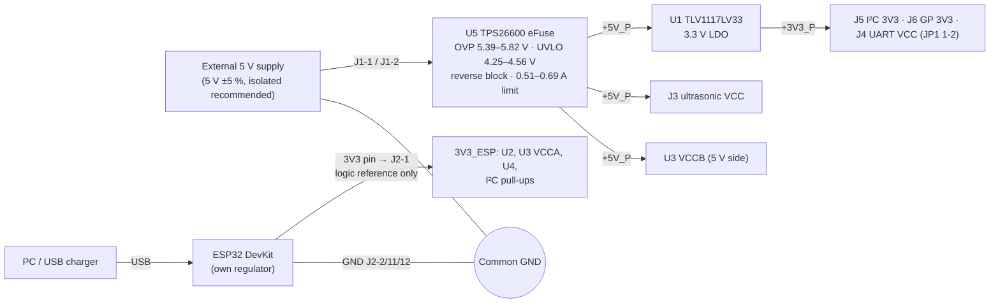

# Board Connection Guide — Sensor Interface & Power Management Board (Rev A)

> **Status: digitally validated design — NOT physically fabricated or tested.** Treat the first boards as
> prototypes and follow the bring-up order in [PHYSICAL_VALIDATION_STATUS.md](../validation/PHYSICAL_VALIDATION_STATUS.md).

This board does **not** contain an ESP32. It is an interface and power board that sits next to an
**ESP32 DevKit** (designed against the ESP32-DevKitC V4 / ESP32-WROOM-32E pin labels) and connects to it with wires.

## 1. Power architecture (read first)

- The **ESP32 is powered by its own USB cable**. The board is powered only through **J1**.
- **Common ground:** J2 pins 2, 11 and 12 connect the DevKit GND to the board GND. This is required for the signals.
- `+3V3_P` (board LDO, for peripherals) and `3V3_ESP` (DevKit 3V3 pin, logic reference) are **never connected**.
  Do not add a wire between them.
- **Do not connect the DevKit 5V/VIN pin to anything on this board.** It would back-feed one supply into the other.
- **Power-up rule R-31 (also printed on the board):** switch on the board **before or together with** the ESP32.
  Check that LED1 (red, +5 V) is on before you plug in the ESP32 USB cable. If the board is off while the ESP32
  is on, small currents (≤ 2.5 mA via the I²C pull-ups, ≤ 12 mA via UART TX) flow into unpowered peripherals.

## 2. Electrical ratings (design values, CALCULATED, not measured)
| Item | Rating |
|---|---|
| Input J1 | 5.0 V ±5 % DC. The eFuse turns the board off above 5.39–5.82 V and below 4.25–4.56 V (rising) |
| Input reverse polarity | Blocked up to −50 V at J1 (C12 rating) **only if no other earthed equipment shares GND** (see §7) |
| Total input current | Limited to 0.51–0.69 A by the eFuse |
| `+5V_P` (J3 VCC) | Input voltage minus ≤ 0.07 V (eFuse RON). Design budget for all direct +5 V loads (sensor, LEDs, translator) is 22.5 mA. The total of +5 V loads and the LDO input must stay below the 0.51 A eFuse limit |
| `+3V3_P` (J4/J5/J6) | 3.3 V, **≤ 250 mA total continuous at ≤ 50 °C ambient** (LDO thermal limit) |
| Logic levels to ESP32 | 3.3 V only |

## 3. Connector pinouts (pin 1 = square pad)
### J1 — Power input (2-pos screw terminal, 5.08 mm, Phoenix 1715721)
| Pin | Signal | Voltage | Direction | Destination | Notes |
|---|---|---|---|---|---|
| 1 | VIN | +5 V | in | 5 V supply **+** | marked ▸ on the board; upper position |
| 2 | GND | 0 V | — | 5 V supply **−** | board ground |

### J2 — ESP32 DevKit interface (1×12 header, 2.54 mm)
| Pin | Signal | Voltage | Direction (board view) | ESP32 DevKit pin | Notes |
|---|---|---|---|---|---|
| 1 | 3V3_ESP | 3.3 V | in | **3V3** | logic reference only (≤ 3.4 mA); not a power output |
| 2 | GND | 0 V | — | GND | common ground |
| 3 | US_TRIG_ESP | 3.3 V | in | **GPIO26** | ultrasonic TRIG, translated to 5 V |
| 4 | US_ECHO_ESP | 3.3 V | out | **GPIO34** | ultrasonic ECHO (GPIO34 is input-only) |
| 5 | I2C_SDA | 3.3 V | bidir | **GPIO21** | 2.2 kΩ pull-up on board |
| 6 | I2C_SCL | 3.3 V | bidir | **GPIO22** | 2.2 kΩ pull-up on board |
| 7 | UART_TX_ESP | 3.3 V | in | **GPIO17 (TX2)** | to J4-3 via 220 Ω |
| 8 | UART_RX_ESP | 3.3 V | out | **GPIO16 (RX2)** | from J4-4 via buffer U4 |
| 9 | GP_IO1_ESP | 3.3 V | bidir | **GPIO32** | to J6-3 via 1 kΩ |
| 10 | GP_IO2_ESP | 3.3 V | bidir | **GPIO33** | to J6-4 via 1 kΩ |
| 11 | GND | 0 V | — | GND | |
| 12 | GND | 0 V | — | GND | |

### J3 — Ultrasonic sensor (1×4 header) — HC-SR04-style 5 V modules
| Pin | Signal | Voltage | Direction | Sensor pin (by label) | Notes |
|---|---|---|---|---|---|
| 1 | +5V | +5 V | out | **VCC** | from the eFuse output |
| 2 | TRIG | 5 V CMOS | out | **Trig** | via 1 kΩ (R15), pulled low at reset |
| 3 | ECHO | 0–5 V | in | **Echo** | 5 V tolerant; buffered to 3.3 V for GPIO34 |
| 4 | GND | 0 V | — | **GND** | |

**Connect the sensor with four separate female–female jumper wires, matching the labels printed on the sensor
to the labels printed next to J3.** The physical pin order of HC-SR04-style modules is not guaranteed to be the
same across manufacturers and has **not been verified** for any specific module. Do not plug a module directly
into J3 unless you have checked that its pin order is VCC-Trig-Echo-GND with pin 1 at the top.

### J4 — UART (1×4 header)
| Pin | Signal | Voltage | Direction | Destination | Notes |
|---|---|---|---|---|---|
| 1 | GND | 0 V | — | device GND | |
| 2 | VCC | 3.3 V (default) / 5 V | out | device VCC | select with JP1: pads 1-2 = 3.3 V (factory bridge), 2-3 = 5 V (cut 1-2 first) |
| 3 | TX | 3.3 V | out | device **RX** | ESP32 GPIO17 through 220 Ω. The device must accept 3.3 V logic even when powered from 5 V |
| 4 | RX | 3.3 V or 5 V | in | device **TX** | buffered to GPIO16; 100 kΩ pull-up to 3V3_ESP |

### J5 — I²C (1×4 header)
| Pin | Signal | Voltage | Direction | Destination | Notes |
|---|---|---|---|---|---|
| 1 | GND | 0 V | — | module GND | |
| 2 | 3V3 | 3.3 V | out | module VCC | from the board LDO (+3V3_P) |
| 3 | SDA | 3.3 V | bidir | module SDA | 2.2 kΩ pull-up to 3V3_ESP |
| 4 | SCL | 3.3 V | bidir | module SCL | 2.2 kΩ pull-up to 3V3_ESP |

Cut **JP2** to remove the on-board pull-ups when the modules already have strong pull-ups (≤ 4.7 kΩ).

### J6 — General-purpose I/O (1×4 header)
| Pin | Signal | Voltage | Direction | Destination | Notes |
|---|---|---|---|---|---|
| 1 | GND | 0 V | — | GND | |
| 2 | 3V3 | 3.3 V | out | device VCC | +3V3_P |
| 3 | IO1 | **3.3 V only** | bidir | GPIO32 via 1 kΩ | **not 5 V tolerant** |
| 4 | IO2 | **3.3 V only** | bidir | GPIO33 via 1 kΩ | **not 5 V tolerant** |

## 4. GPIO assignment summary
| ESP32 GPIO | Function | Board connector |
|---|---|---|
| GPIO26 | Ultrasonic TRIG (output) | J2-3 → J3-2 |
| GPIO34 | Ultrasonic ECHO (input-only pin) | J3-3 → J2-4 |
| GPIO21 / GPIO22 | I²C SDA / SCL | J2-5/6 ↔ J5-3/4 |
| GPIO17 / GPIO16 | UART2 TX / RX | J2-7 → J4-3, J4-4 → J2-8 |
| GPIO32 / GPIO33 | General purpose I/O | J2-9/10 ↔ J6-3/4 |

## 5. Wiring diagram
```text
 ESP32 DevKit (USB-powered)          THIS BOARD                         PERIPHERALS
 ┌──────────────┐  12 wires   ┌──────────────────────────┐
 │ 3V3   ───────┼─────────────┤ J2-1  3V3_ESP (reference) │
 │ GND   ───────┼─────────────┤ J2-2, J2-11, J2-12 GND    │
 │ GPIO26 ──────┼─────────────┤ J2-3  TRIG ─▶ U3 ─▶ J3-2 ├── Trig  ┐
 │ GPIO34 ──────┼─────────────┤ J2-4  ECHO ◀─ U2 ◀─ J3-3 ├── Echo  │ Ultrasonic
 │ GPIO21 ──────┼─────────────┤ J2-5  SDA ─────── J5-3    │   +5V J3-1 ── VCC
 │ GPIO22 ──────┼─────────────┤ J2-6  SCL ─────── J5-4    │   GND J3-4 ── GND ┘
 │ GPIO17 ──────┼─────────────┤ J2-7  TX ──────── J4-3    ├── RX  (UART device)
 │ GPIO16 ──────┼─────────────┤ J2-8  RX ◀─ U4 ── J4-4    ├── TX
 │ GPIO32 ──────┼─────────────┤ J2-9  IO1 ─ 1k ── J6-3    │
 │ GPIO33 ──────┼─────────────┤ J2-10 IO2 ─ 1k ── J6-4    │
 │ 5V/VIN  ✗ not connected    │                          │
 └──────────────┘             │ J1-1 +5V ◀── 5 V supply + │
                              │ J1-2 GND ◀── 5 V supply − │
                              └──────────────────────────┘
```

## 6. First connection procedure
1. Before connecting anything, check the J1 wiring polarity with a meter (pin 1 = +, the triangle marker).
2. Connect J1 to a current-limited 5 V supply (set ≤ 0.3 A for the first power-up). Switch it on.
3. LED1 (red) and LED2 (green) should light. Measure TP2 ≈ 5 V and TP3 ≈ 3.3 V.
4. Only then connect the ESP32 DevKit USB cable, with the 12 J2 wires already in place.
5. Connect peripherals with the board powered off.

## 7. Reverse polarity and earthed equipment (important)
The eFuse blocks a reversed supply **only on the 5 V path**. The ground path is common to the board, the ESP32
and the USB host. If the 5 V supply's negative terminal is earthed (many bench supplies) and the ESP32 is connected
by USB to an earthed PC, a reversed J1 connection **short-circuits the supply through the board ground, the J2 GND
wires, the DevKit and the USB cable**. The eFuse cannot stop this. Use an isolated supply, and always follow §6
(check polarity, power the board first, connect USB last). Details:
[SAFETY_AND_POWER.md](../safety/SAFETY_AND_POWER.md).
