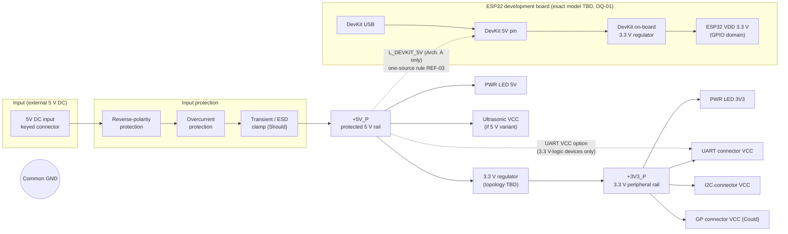
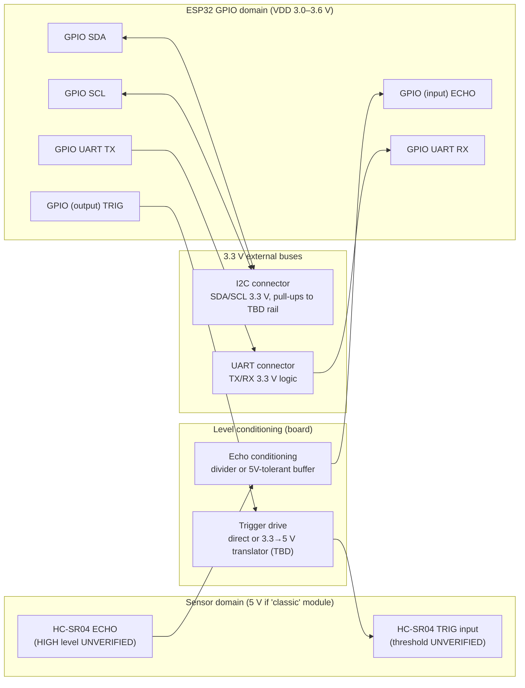

# Block Diagram — V0.1.0 (planning)

Voltage domains are kept separate. No line connects a 5 V signal directly to an ESP32 GPIO.
The dashed link `L_DEVKIT_5V` exists **only** in Architecture A and is open in Architecture B.

## System and power architecture

Notes:
- `+3V3_P` and the DevKit's 3.3 V are **different rails**. They are never tied together (PWR-08).
- In Architecture A, the DevKit's USB and `L_DEVKIT_5V` must never supply the DevKit at the same time.
  How this is enforced is an open design decision (OQ-06, R-03).

## Signal paths

- Echo conditioning options are evaluated in INTERFACE_SPEC §2 (divider math in
  `calculations/v0.1.0/phase1_calcs_output.txt` §2).
- I2C and UART are 3.3 V logic only (I2C-02, UART-02). 5 V-logic devices are out of scope unless a
  translator is added.

## Power architecture options (summary; detail in POWER_BUDGET)
| Option | Description | Verdict (Phase 1) |
|---|---|---|
| **A** | Board powers the DevKit through its 5 V pin (`L_DEVKIT_5V` fitted). One supply for everything | Viable only with an enforced one-source rule (no simultaneous USB). Input path rated about 1 A |
| **B** | DevKit powered by its own USB. Board powers peripherals only. Common GND | Complies with REF-03 by construction. Lower input current (about 0.35 A). Back-powering risk on signal lines when the ESP32 is off (R-04) |
| C | Board 3.3 V feeds the DevKit 3V3 pin | **Rejected**: bypasses and conflicts with the DevKit regulator, violates the one-source rule whenever USB is connected |
| A/B selectable | Removable link (`L_DEVKIT_5V`) with B as default | Candidate. Needs an unambiguous label and a USB-presence rule. Decision OQ-06 |
