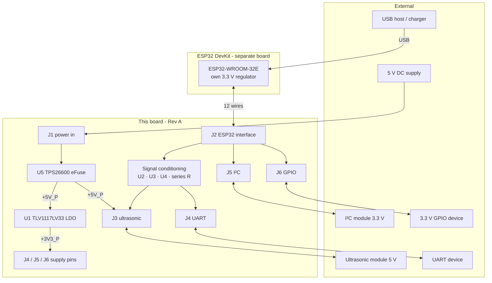
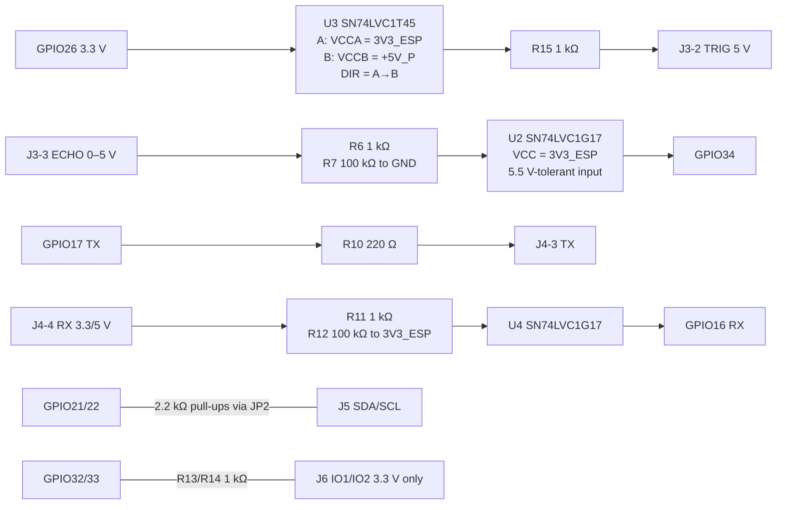

# Board Architecture — Sensor Interface & Power Management Board

The board sits between an **ESP32 DevKit** and 5 V / 3.3 V peripherals. It provides protected power from an
external 5 V supply, a 3.3 V peripheral rail, 3.3 V ↔ 5 V signal conditioning for an HC-SR04-style ultrasonic
sensor, and labelled I²C, UART and GPIO headers. The ESP32 is **not** on the board.

> The AI toolchain used to design the board (Claude Code → MCP → KiCad) is described separately in
> [`docs/SYSTEM_ARCHITECTURE.md`](../SYSTEM_ARCHITECTURE.md) and [`docs/ai-workflow/`](../ai-workflow/).

## 1. System view (Architecture B)

## 2. Power domains
| Domain | Source | Supplies | Notes |
|---|---|---|---|
| VIN_RAW | J1 (5 V ±5 %) | U5 input only | Unprotected side of the eFuse |
| +5V_P | U5 OUT | U1 input, J3 VCC, U3 VCCB (5 V side), LED1 | Protected 5 V |
| +3V3_P | U1 | J4 VCC (JP1 default), J5-2, J6-2, LED2 | ≤ 250 mA at ≤ 50 °C |
| 3V3_ESP | DevKit 3V3 pin via J2-1 | U2, U4, U3 VCCA, I²C pull-ups, UART RX pull-up | Logic reference only, ≤ 3.4 mA |
| EF_RTN | U5 RTN | UVLO/OVP divider, ILIM, dVdT, U5 PowerPAD | Isolated island, **not GND** |
| GND | J1-2, J2-2/11/12 | everything else | Common with the DevKit and USB host |

`+3V3_P` and `3V3_ESP` never share a node (checked by the netlist verifier).

## 3. Signal conditioning

R4 and R5 (100 kΩ) hold TRIG low on both sides of U3 while the ESP32 is in reset or unpowered.
