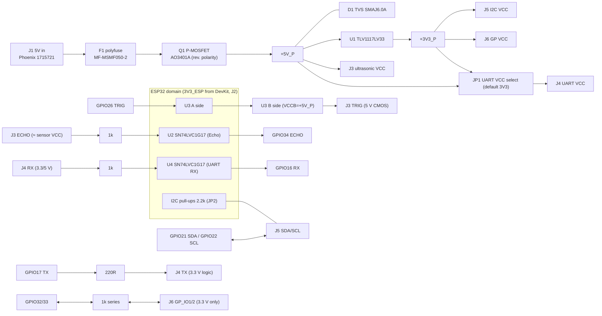

# System Architecture — V0.1.0 (Sensor Interface & Power Management Board for ESP32)

## Context
An external companion board. The ESP32 development board stays on its own USB supply
(**Architecture B**, see POWER_ARCHITECTURE.md). The board takes a separate 5 V input and powers,
protects and level-conditions the external peripherals.

## Platform
| Item | Value | Evidence |
|---|---|---|
| User's board (provisional description) | ESP32 with ESP-WROOM-32 module, USB-C, CP2102 USB-UART, 2 header rows, likely 38-pin | user description, not verified physically |
| Closest documented board | Espressif **ESP32-DevKitC V4** (38-pin, 2 × 19 headers) | DS-02b |
| Chip-level electrical limits | ESP32 Series Datasheet v5.3 + WROOM-32E v2.1 (same IO electrical class) | DS-01/02 |
| Mechanical interface | **Provisional**: 1×12 header (J2) wired to the DevKit (Option B below). No DevKit dimensions assumed | — |

## Voltage domains
| Domain | Net | Source | Consumers |
|---|---|---|---|
| Raw input | `VIN_RAW`, `VIN_FUSED` | J1 (5 V ±5 % spec) | polyfuse, reverse-polarity FET |
| Protected 5 V | `+5V_P` | after F1 + Q1, clamped by D1 | ultrasonic VCC (J3), LVC1T45 VCCB, LDO input, LED1, UART VCC option |
| Board 3.3 V | `+3V3_P` | U1 TLV1117LV33 | I2C VCC (J5), GP VCC (J6), UART VCC default, LED2 |
| ESP32 reference 3.3 V | `3V3_ESP` | DevKit 3V3 pin via J2-1 (**sinks no power into the DevKit**) | U2/U4 VCC, U3 VCCA and DIR, I2C pull-ups (via JP2), UART RX pull-up. About 3.4 mA max |
| Ground | `GND` | common (J1-2, J2-2/11/12) | all |

`+3V3_P` and `3V3_ESP` are separate nets with no common node, which the verifier checks automatically.

## Block diagram

## GPIO assignment (ESP32 GPIO numbers; DevKit header positions are wired by label)
| Function | GPIO | Direction | Why this pin (DS-01) |
|---|---|---|---|
| US_ECHO_ESP | **34** | in | input-only pin (no output driver needed), not strapping, ADC1_CH6 |
| US_TRIG_ESP | **26** | out | general-purpose output, not strapping, not flash |
| I2C_SDA / I2C_SCL | **21 / 22** | open-drain | not strapping/flash. The common ESP32 Arduino defaults (convention, not a hardware restriction) |
| UART_TX_ESP / UART_RX_ESP | **17 / 16** | out / in | UART2 (UART0 GPIO1/3 is used by the CP2102 bridge). Available on WROOM modules (not WROVER, DS-02b) |
| GP_IO1 / GP_IO2 | **32 / 33** | in/out | ADC1_CH4/CH5, not strapping |
Excluded: GPIO0, 2, 5, 12, 15 (strapping, DS-01 Table 3-1). GPIO6–11 (flash). GPIO1/3 (USB-UART).

## Mechanical integration: options
| Criterion | A. Female headers on the PCB (DevKit plugs in) | B. Header + cable/jumper wires (chosen for V0.1.0) |
|---|---|---|
| Electrical reliability | Very good (short, fixed) | Good for signal levels. Loose-wire risk mitigated by labels |
| Assembly | Needs 2 × 19 sockets at exact pitch and row spacing | One 1×12 header |
| Mechanical compatibility | **Requires a verified drawing** of the user's clone (row spacing, length, USB-C overhang). Not available | Independent of the DevKit variant |
| Usability | Plug-and-play, but the antenna sits over the board (keep-out needed) | Flexible placement. Wiring step required |
| Decision | Deferred to V0.2.0 after measuring the physical board | **Selected now**: electrical design complete without mechanical assumptions |
